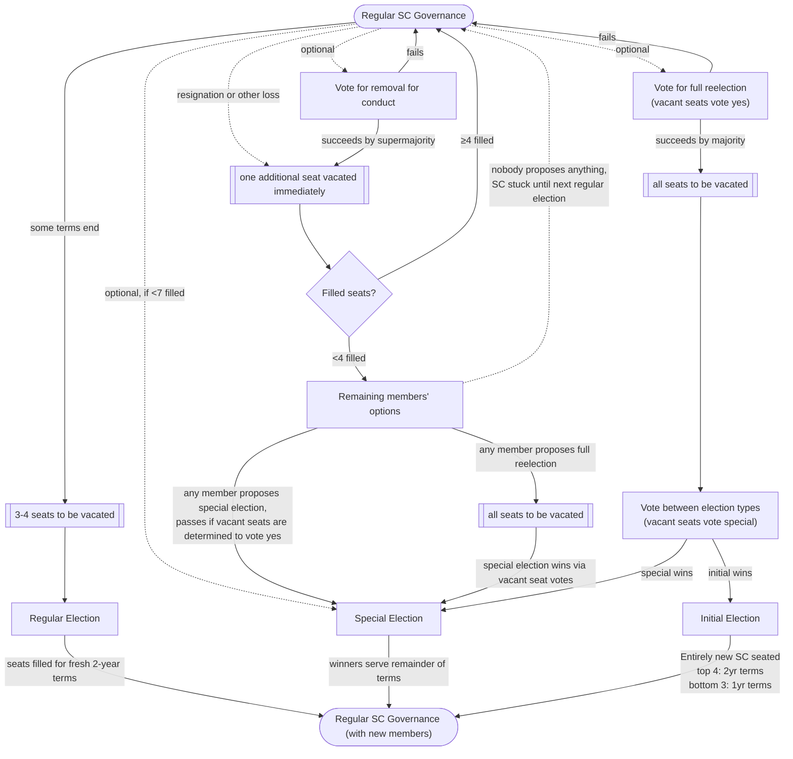

# Constitution Commentary

This document contains a non-normative, non-binding commentary on the [constitution], explaining some subtleties.

> [!TIP]
>
> This document is believed to be up to date with the constitution as of [`489d0cc1664fad2539ba7fa17f80467468ef4e01`](https://github.com/NixOS/org/blob/489d0cc1664fad2539ba7fa17f80467468ef4e01/doc/constitution.md).
> If the constitution is amended, please update the above commit hash (after revising this document as needed).
> This way, we might distinguish between not needing changes to the commentary versus forgetting to update it.

## SC Election and Removal procedure

The state machine of the portions of the constitution that govern the composition of the SC (what seats are filled, who is in which seat) is especially complex.
The following flow chart diagrams this state machine.
(The [Conflict of Interest (CoI) Balance][conflict of interest balance] mechanism is ignored in this section for simplicity.)

### Deferred versus immediate loss of members

A [no-confidence vote][full reelection] does not immediately dissolve the SC.
It just triggers the [full reelection] (which presumably cannot be cancelled) after which all current SC members lose their seats (unless reelected).
By contrast, [removal for conduct] does immediately remove an SC member.

Voluntary resignations are a grey area.
In the above diagram they are also diagrammed as immediately taking effect, but arguably they could also be deferred until the election when those seats are replaced.

The important part of this distinction is who is a member voting in subsequent votes.
Members removed for conduct do not vote to choose the election type (in the [no-confidence][full reelection] case) or whether to hold a [special election] (in the seats-vacated case).
Members not resigning absolutely do vote in both those cases.
Voluntarily-resigning members are a grey area.

### When the SC drops below 4 members

The most subtle part is what happens when the SC drops below 4 members due to ["resignation or other loss"][special election] or removal for conduct.

The constitution [states][special election] that when less than half of the seats are filled, a special election may occur.
Separately, a vote of no-confidence, triggering a [full reelection], can presumably occur at any time.
Therefore, that can also occur instead at this point, leading indeed to a special election also, but a different sort of special election.
If any SC member proposes a [no-confidence vote][full reelection], the vote will automatically win due to how vacant seats are counted for such votes.
However, vacant seats do not trigger votes, they only vote once a sitting member triggers a vote.

Taken all together, there are 3 outcomes:

- No one left proposes a vote: the SC continues unable to do anything until the next regularly-scheduled election.

- At least one person proposes a special election to fill just the empty seats.
  This passes if the ["Vacant seats vote in favour of reelection..."][full reelection] sentence is meant to apply in both the case of empty-seat-filling special elections and [no-confidence full elections][full reelection] (which may be [special][special election] or initial).

- At least one person proposes a [full election][full reelection] to replace everyone.
  This passes, as the aforementioned sentence is unambiguously in the [Full Reelections][full reelection] section.
  The vacant seats will also automatically cause a special election, rather than an initial election to be chosen.
  A [full reelection] in the form of an initial election is not possible with fewer than 4 members remaining.

[constitution]: ./constitution.md
[conflict of interest balance]: ./constitution.md#conflict-of-interest-coi-balance
[full reelection]: ./constitution.md#full-reelections
[removal for conduct]: ./constitution.md#removal-for-conduct
[special election]: ./constitution.md#special-elections
