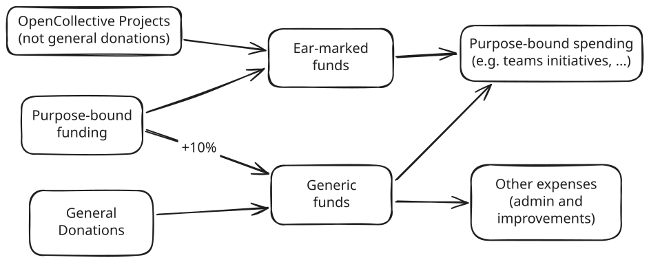
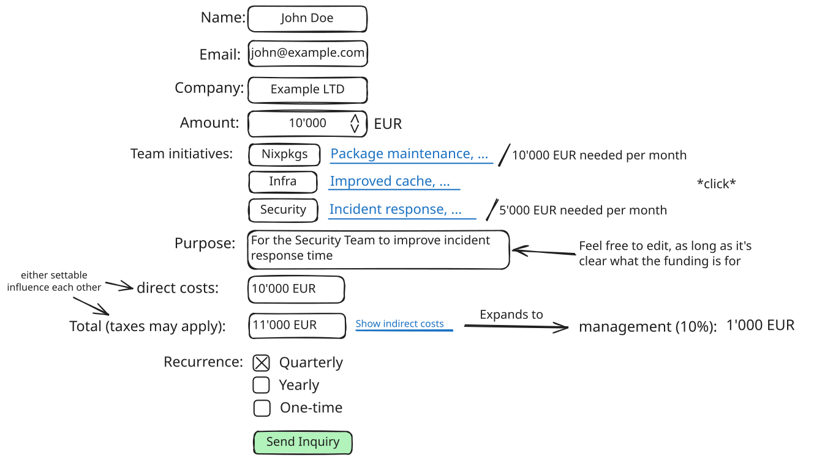

# Proposal: Grant program and purpose-bound funding

Alternative title: Filling funding flow gaps

## Motivation

- Enable companies to finance Nix ecosystem improvements in a more streamlined and transparent way
- Enable contributors to get paid for working on Nix ecosystem improvements in a more streamlined way
- Provide a way to connect funding partners to contributing individuals, e.g. for when:
  - Individuals don't want to be employed/contracted directly by a company, and don't want to be limited by receiving funding from only one company
  - Companies don't want to employ/contract an individual directly, and want to provide funding in a more flexible way to multiple individuals
  - Companies want a trusted third-party to hold the funds until work is complete
- Strengthen the ecosystem by providing funding resources to contributors using general NixOS Foundation donation profits not tied to any companies

# Detailed Design

There are two inter-related parts to this proposal:

- Team initiatives: A way for teams to request funding, which can come either from general-purpose donations or purpose-bound funding
- Purpose-bound funding: A way for companies to provide funding for specific team initiatives or other purposes.

([source](https://excalidraw.com/#json=tFZqsU7BVB4044SLNsZqY,ioPMoEaXe2oQjQS7HQgFaQ), make sure to update the source link when changing anything)

## Team initiatives

Create a process for teams submitting initiatives for funding.

- Official teams can submit initiatives by creating a PR against the nixos-homepage repo, which is reviewed by the board/SC before merged. Team initiatives consist of a title, description and link to more info (e.g. a team roadmap, repo, board, ...)
  - Communication between a team representative and the board will be established to synchronise on available funding and team needs
- The board may allocate part of the income and ear-marked funds towards team initiatives
- If there's a lot of interest by community individuals to support team initiatives, the board can consider creating an OpenCollective crowd-funding campaign for team initiatives
  - As opposed to [purpose-bound funding](#purpose-bound-funding) that come with a contract meant for companies, such crowd-funding campaigns are meant for individuals and are seen as a donation without a contractual guarantee of the funding being used for the stated purpose

## Purpose-bound funding

- Establish a process for going into contracts with companies to supply funding for specific purposes, with a guarantee that part of the funding will be used for the stated purpose, and that what could not be used as such is repurposed according to the funder companies wishes.
  - Funding recommendations for differently sized companies should be given
  - The board ensures standard legal requirements
  - Any software written with this funding must be licensed under an [OSI-approved license](https://opensource.org/licenses)
    - Non-software must be licensed under either CC0, CC BY, or CC BY-SA
  - This can be used for [team-submitted initiatives](#team-initiatives) from the current feedback phase
  - We charge an extra 10% for management of purpose-bound funding
  - Purpose-bound funding can be set up as recurring (quarterly or yearly), which is the recommended option
- Track team initiative funding opportunities and make it easy for companies to stay up-to-date
  - Maintain a page on the website that showcases the opportunities and a contact form (and a direct email) to initiate the process of submitting funding for either a listed opportunity, or other purposes. See below for a rough mockup
  - Create a funding mailing list where every 3 months we send out a list of funding opportunities, such as the initiative funding, and create a signup form on the website

([source](https://excalidraw.com/#json=LUAL9aUsBjiS8XhMaMCTm,k0c9zmEDAeLK-F73_7wrDg), make sure to update the source link when changing anything)

# Considerations

- Why can only businesses (including self-proprietorships) receive grant funding?
  - Because sending funding to non-business entities is legally more tricky to get right. For now we need to keep the setup as simple as possible. We may be able to lift this restriction in the future.
